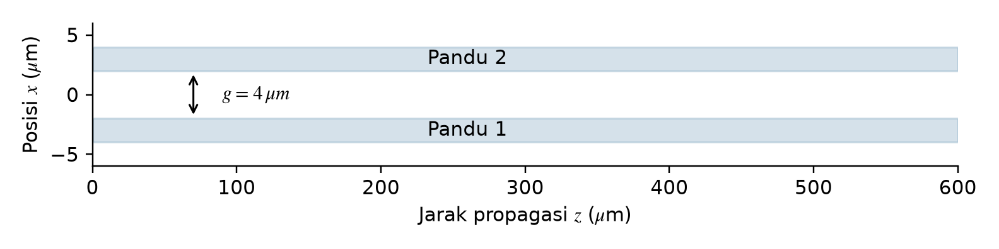
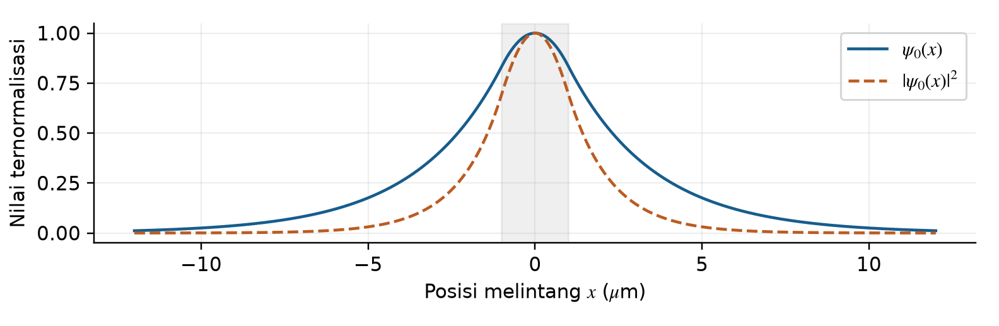
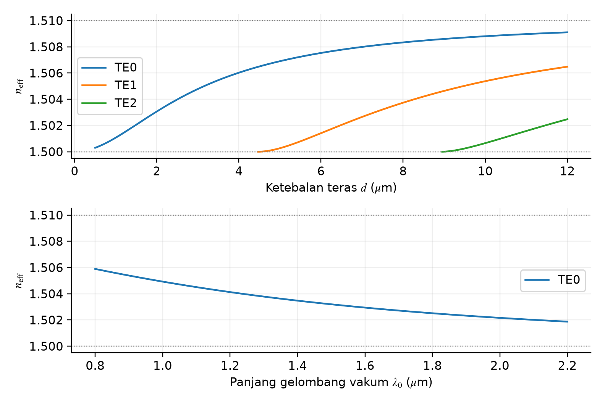
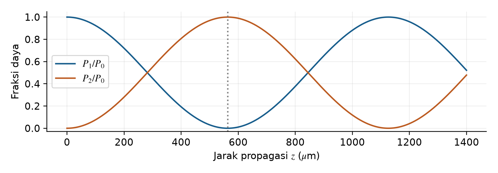
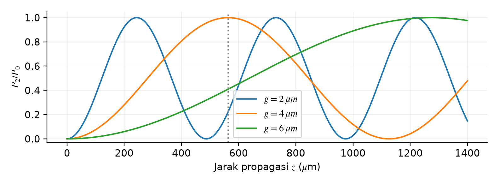

## Analisis dan Simulasi Pandu Gelombang Planar

### Penugasan 1 Optik Modern • Bagian B dan C

### Anggota kelompok

1. Alfreda Maulana Wiryawan (140310240018) 2. Peter Wirasaputra (140310240028) 3. Rafif Yasin Habibullah Wiryawan (140310240044) 4. Muhammad Fithroh Hikmal Labida (140310240046) 5. Muhammad Fadhil Taqiyyudin (140310240050) 6. Khansa Humaira Adhari (140310240068)

## 1 Tujuan dan model fisis

Simulasi ini mempelajari cara cahaya merambat di dalam pandu gelombang planar, yaitu pandu berbentuk lapisan datar. Bagian tengahnya disebut teras, sedangkan lapisan di sekitarnya disebut selubung. Bagian B membahas bentuk medan dan pengaruh ketebalan serta panjang gelombang. Bagian C membahas perpindahan daya antara dua pandu yang berdekatan.

Pandu dianggap sangat lebar pada arah y dan bentuknya tetap sepanjang arah rambat z. Sifat bahan dianggap sama ke segala arah dan tidak menyerap cahaya. Polarisasi TE berarti medan listrik sejajar arah y. Simbol d adalah ketebalan penuh teras, sedangkan g adalah lebar celah dari tepi satu teras ke tepi teras lainnya. Modus adalah pola medan yang dapat merambat dengan bentuk melintang yang tetap.

| Parameter | Nilai dan alasan |

| --- | --- |

| Indeks teras n₁ dan selubung n₂ | 1,51 dan 1,50; selisih kecil agar medan yang masuk ke selubung mudah diamati |

| Ketebalan teras d | 2,00 µm; menghasilkan satu modus pada kondisi acuan |

| Panjang gelombang vakum λ₀ | 1,55 µm; dipilih sebagai contoh rentang inframerah |

| Variasi Bagian B | d = 0,5–12 µm; λ₀ = 0,8–2,2 µm; divariasikan satu per satu |

| Variasi Bagian C | g = 2, 4, dan 6 µm; d dan λ₀ tetap pada nilai acuan |

Nilai pada tabel dipilih sebagai contoh perhitungan, bukan data hasil pengukuran bahan tertentu. Indeks bias bahan dibuat tetap meskipun panjang gelombang diubah. Dengan demikian, perubahan hasil berasal dari pengaruh struktur pandu. Perubahan indeks bias bahan terhadap panjang gelombang belum diperhitungkan.

Gambar 1. Geometri dua pandu identik pada celah acuan 4 µm.

---

## 2 Persamaan dan metode numerik

Bentuk medan pada arah melintang dinyatakan dengan ψ(x). Bentuk ini dihitung menggunakan persamaan Helmholtz berikut. Besaran β menyatakan perubahan fase per satuan jarak rambat, k₀ adalah bilangan gelombang di vakum, dan neff adalah indeks bias efektif yang menggambarkan perambatan suatu modus.

$$
\frac{d^2\psi}{dx^2}+[k_0^2n^2(x)-\beta^2]\psi=0,\qquad k_0=\frac{2\pi}{\lambda_0},\quad n_{\mathrm{eff}}=\frac{\beta}{k_0}
$$

Agar cahaya tetap terpandu, medan harus berbentuk gelombang di teras dan semakin kecil ketika menjauhi teras. Syaratnya adalah n₂ &lt; neff &lt; n₁. Untuk memudahkan perhitungan, digunakan V dan b yang tidak memiliki satuan. Di sini, V memakai ketebalan penuh d. Nilai b berada di antara 0 dan 1.

$$
V=k_0d\sqrt{n_1^2-n_2^2},\qquad b=\frac{n_{\mathrm{eff}}^2-n_2^2}{n_1^2-n_2^2}
$$

$$
V\sqrt{1-b}-m\pi-2\tan^{-1}\!\sqrt{\frac{b}{1-b}}=0,\qquad 0<b<1
$$

Nilai b dicari dengan biseksi, yaitu membagi dua rentang pencarian secara berulang sampai ditemukan nilai yang membuat persamaan mendekati nol. Nomor m = 0, 1, 2, … menyatakan urutan modus. Modus hanya dihitung jika V &gt; mπ. Batas kemunculan modus disebut cutoff. Lebar rentang pencarian akhir dibuat kurang dari 10⁻¹³.

$$
\beta=k_0n_{\mathrm{eff}},\quad h=k_0\sqrt{n_1^2-n_{\mathrm{eff}}^2},\quad q=k_0\sqrt{n_{\mathrm{eff}}^2-n_2^2}
$$

Setelah b diperoleh, indeks bias efektif dihitung dari definisi b. Selanjutnya β, h, dan q dihitung dengan rumus di atas. Besaran h menentukan perubahan medan di teras, sedangkan q menentukan seberapa cepat medan mengecil di selubung. Ketiganya memiliki satuan µm⁻¹. Untuk TE₀, medan di teras mengikuti cos(hx) dan di selubung mengecil secara eksponensial.

Gambar 2. Profil TE₀ dan kuadrat amplitudonya pada d = 2 µm dan λ₀ = 1,55 µm.

Hasilnya adalah neff = 1,503065 dan β = 6,092927 µm⁻¹. Pada Gambar 2, medan paling besar berada di tengah teras dan tidak memiliki titik nol di dalam teras. Sebagian medan tetap masuk ke selubung. Setelah berjarak 1/q = 2,571 µm dari tepi teras, amplitudonya turun menjadi sekitar 37% dari nilai di tepi.

---

## 3 Pengaruh ketebalan dan panjang gelombang

Gambar 3. Indeks bias efektif terhadap ketebalan pada λ₀ = 1,55 µm (atas), dan terhadap panjang gelombang pada d = 2 µm (bawah).

Semakin tebal teras, semakin besar nilai V dan semakin kuat medan terpusat di dalam teras. Karena itu, indeks bias efektif mendekati indeks teras. Modus TE₁ mulai muncul ketika ketebalan melewati sekitar 4,467 µm, sedangkan TE₂ muncul setelah 8,934 µm. Pada d = 2 µm hanya ada TE₀. Batas ketebalan untuk modus yang lebih tinggi dihitung dengan rumus berikut.

$$
d_{c,m}=\frac{m\lambda_0}{2\sqrt{n_1^2-n_2^2}},\qquad m=1,2,\ldots
$$

Jika ketebalan tetap, panjang gelombang yang lebih besar membuat V dan indeks bias efektif menurun. Medan menjadi lebih menyebar ke selubung. Pada d = 2 µm dan rentang panjang gelombang 0,8–2,2 µm, jumlah modus tetap satu. Itulah sebabnya grafik bawah hanya menunjukkan TE₀.

Animasi menampilkan medan ψ(x) cos(βz − ωt), dengan ω sebagai frekuensi sudut dan t sebagai waktu. Biru dan oranye menandai medan bernilai negatif dan positif, bukan warna asli cahaya. Untuk satu modus tanpa kehilangan daya, intensitas rata-rata sebanding dengan |ψ|² dan tetap sepanjang z. Jadi, pergantian warna pada animasi tidak berarti daya berpindah ke selubung.

---

## 4 Perpindahan daya pada directional coupler

Medan yang masuk ke selubung disebut medan evanescent. Jika dua pandu cukup dekat, bagian medan ini saling bertumpang tindih sehingga daya dapat berpindah. Gabungan dua pandu memiliki dua pola medan, disebut supermodus: genap dan ganjil. Keduanya memiliki nilai β yang berbeda. Saat digabungkan, perbedaan fase keduanya membuat daya bergantian terkumpul pada masing-masing pandu.

Program menghitung kedua supermodus pada susunan selubung–teras–celah–teras–selubung. Medan dan turunannya harus tersambung di setiap batas lapisan. Di selubung luar, medan harus semakin kecil, sehingga berlaku E′ + qE = 0. Nilai βₑ dan βₒ yang memenuhi syarat ini dipakai untuk menghitung kekuatan kopling κ dan jarak transfer penuh Lc.

$$
\kappa=\frac{\beta_e-\beta_o}{2},\qquad L_c=\frac{\pi}{2\kappa},\qquad L_{50:50}=\frac{L_c}{2}
$$

$$
\frac{P_1(z)}{P_0}=\cos^2(\kappa z),\qquad \frac{P_2(z)}{P_0}=\sin^2(\kappa z)
$$

P₀ adalah daya total masukan, sedangkan P₁ dan P₂ menunjukkan pembagian daya pada dua kanal dalam model. Kanal ini dibentuk dari gabungan kedua supermodus dan mewakili daya yang terutama berada di masing-masing pandu. Perhitungannya mencakup medan di selubung, sehingga tidak sama dengan menjumlahkan intensitas hanya di dalam teras.

Gambar 4. Perpindahan daya modal untuk g = 4 µm. Garis tegak menandai Lc.

Untuk g = 4 µm, diperoleh κ = 0,00278959 µm⁻¹. Pada z = 0, daya berada pada kanal 1. Setelah merambat 281,55 µm, daya terbagi sama besar. Pada 563,09 µm, daya berpindah penuh ke kanal 2 dalam model ini. Pada 1126,19 µm, daya kembali ke kanal 1. Total P₁ + P₂ tetap sama dengan P₀ karena kehilangan daya tidak dimasukkan.

Kopler dapat menjadi pembagi daya 50:50 jika panjangnya Lc/2. Jika panjangnya Lc, keluaran berpindah ke kanal kedua; pada 2Lc, keluaran kembali ke kanal pertama. Untuk menjadi sakelar yang bisa diatur saat digunakan, perlu ada pengendali, misalnya pengubah indeks bias. Simulasi ini belum memasukkan pengendali tersebut.

---

## 5 Pengaruh jarak antarpandu

Gambar 5. Perbandingan daya kanal 2 untuk tiga celah pada rentang propagasi yang sama.

| g (µm) | κ (µm⁻¹) | Lc (µm) | P₂/P₀ pada z = 563,09 µm |

| --- | --- | --- | --- |

| 2 | 0.00644965 | 243.55 | 22.16% |

| 4 | 0.00278959 | 563.09 | 100.00% |

| 6 | 0.00123306 | 1273.90 | 40.94% |

Semakin kecil celah, semakin kuat interaksi medan kedua pandu. Nilai κ menjadi lebih besar sehingga daya berpindah dalam jarak yang lebih pendek. Saat celah diperbesar dari 2 menjadi 6 µm, κ menjadi sekitar 5,23 kali lebih kecil. Sebaliknya, Lc menjadi sekitar 5,23 kali lebih panjang, dari 243,55 menjadi 1273,90 µm.

Celah yang lebih kecil tidak selalu menghasilkan daya keluaran kanal 2 yang lebih besar pada panjang perangkat yang sama. Pada z = 563,09 µm, kopler bercelah 2 µm sudah melewati transfer penuh pertama, lalu sebagian dayanya kembali ke kanal 1. Akibatnya, daya kanal 2 hanya 22,16%. Pada posisi yang sama, celah 4 µm menghasilkan 100% dan celah 6 µm menghasilkan 40,94%.

Hasil ini menunjukkan bahwa celah dan panjang perangkat perlu dipilih bersama. Celah menentukan seberapa kuat kedua pandu saling berinteraksi, sedangkan panjang perangkat menentukan posisi keluaran pada siklus perpindahan daya. Belum dapat disimpulkan bahwa celah lebih berpengaruh daripada indeks bias atau panjang gelombang, karena kedua parameter itu belum divariasikan pada kopler.

### Batas model yang digunakan

Hasil berlaku untuk dua pandu yang sama bentuk dan bahannya, sejajar, serta tidak kehilangan daya. Angka 100% mengacu pada pembagian daya antarkanal dalam model; medan di teras lain belum tentu tepat nol. Pengaruh belokan, pantulan di masukan, permukaan yang kasar, penyerapan cahaya, polarisasi TM, dan bentuk tiga dimensi belum dihitung.

---

## 6 Analisis kode dan pemeriksaan hasil

Kode dibagi menjadi dua berkas utama. optik_model.py berisi rumus dan langkah perhitungan fisika. simulasi_interaktif.py memakai hasilnya untuk menampilkan grafik dan animasi melalui Tkinter dan Matplotlib. Saat slider digeser, program menghitung ulang hasil sesuai nilai yang dipilih.

| Fungsi pada optik_model.py | Peran dalam perhitungan |

| --- | --- |

| bisect dan slab_modes | Mencari nilai yang memenuhi persamaan dan menentukan modus yang dapat merambat |

| slab_field | Menghitung bentuk medan di teras dan penurunannya di selubung |

| residual dan coupler | Mencari kedua pola medan gabungan, lalu menghitung κ dan Lc |

| raw_supermode dan supermode_norm | Menghitung medan tiap lapisan dan menyesuaikan skalanya dengan integral |

| basis, intensity, dan powers | Menggabungkan dua pola medan untuk membuat peta intensitas dan pembagian daya |

Program membaca parameter, mencari modus, menghitung medan dan β, lalu menghitung perpindahan daya pada kopler. Hasilnya ditampilkan sebagai grafik dan dapat disimpan sebagai CSV. Skala medan kedua supermodus disesuaikan, termasuk dengan faktor 1/√β, agar pembagian dayanya konsisten. Peta |E|² menunjukkan intensitas relatif, sedangkan P/P₀ menunjukkan bagian daya terhadap daya total.

### Pemeriksaan numerik

Indeks bias efektif hasil perhitungan berada di antara indeks selubung dan teras: 1,50 &lt; 1,503065 &lt; 1,51. Pemeriksaan kode juga lulus untuk panjang kopling, pembagian daya 50:50, transfer penuh, skala medan, pertukaran bentuk medan, dan kemunculan modus di dekat cutoff. Grafik dan CSV berhasil dibuat. Pemeriksaan ini menguji perhitungan program; perbandingan dengan data eksperimen belum dilakukan.

### Cara menjalankan

Pasang pustaka yang tercantum di kode/requirements_interaktif.txt. Dari folder Penugasan 1, jalankan perintah berikut untuk membuka simulasi. Kode disertakan terpisah dari enam halaman laporan.

python kode/simulasi_interaktif.py

Untuk memeriksa hasil tanpa membuka jendela:

python kode/simulasi_interaktif.py --periksa

## 7 Kesimpulan

Pada kondisi awal, pandu hanya memiliki modus TE₀ dengan indeks bias efektif 1,503065. Teras yang lebih tebal membuat medan lebih terpusat dan dapat menambah jumlah modus. Panjang gelombang yang lebih besar membuat medan lebih menyebar. Pada kopler, daya berpindah bolak-balik antara kedua kanal. Celah yang lebih besar membutuhkan jarak transfer yang lebih panjang.

### Referensi

[1] Materi kuliah Bab 4, bagian pandu planar dan directional coupler, terutama Bagian 4.6. [2] Optik Modern Pertemuan 9, Penugasan 1 Bagian B dan C serta ketentuan luaran. Keduanya merupakan berkas materi yang menyertai tugas.
